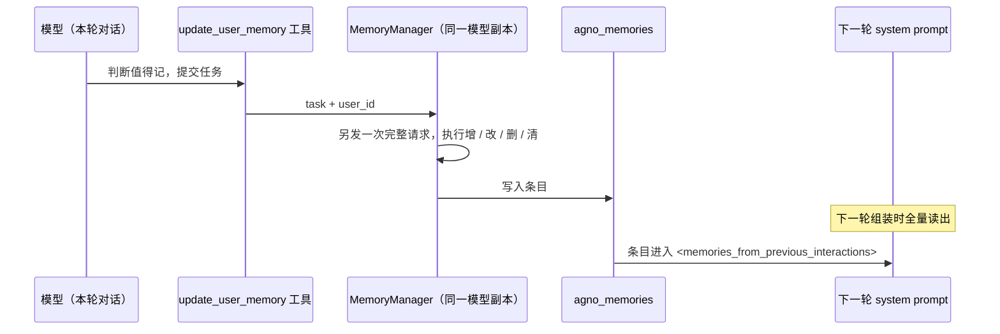

# 记忆分层 — 一次请求里模型看到什么

本文解释「记忆」在运行期的分层：哪些信息进入本次请求、哪些留在库或磁盘、模型与用户各自能看到什么。内置引擎的机制、不变量与设计决议见 [`src/aaa/memory/DESIGN.md`](../src/aaa/memory/DESIGN.md)，系统结构与模块边界见 [`docs/architecture.md`](architecture.md)。

跨会话记忆默认关闭。通过 `/memory engine` 选内置或外置，重启生效。两者互斥，不影响会话历史。

## 一、四层划分

| 层 | 内容 | 存放位置 | 进入本次请求 | 模型可见 | 用户可见 |
|---|---|---|---|---|---|
| 1 窗口内历史 | 上次压缩折叠以来的对话消息 | 会话库，运行时拼装 | 是（受 token 阈值约束） | 是 | 是 |
| 2 压缩摘要与归档 | 老消息的模型摘要；原文逐字归档 | 会话库 | 摘要进入，原文不进 | 摘要与归档检索工具 | 查库 / `/export` |
| 3 会话存档 | 全部会话与每轮消息 | `sessions.db`（`agno_sessions` / `agno_runs`） | 否 | **否**（默认无检索工具） | 是（`/session`、`-c`/`-r`、`/export`） |
| 4 跨会话记忆 | 内置记忆或外置引擎召回 | 内置落 `sessions.db`；外置引擎自管 | 启用时进入上下文 | 启用时可见 | `/memory` 仅查看当前来源 |

另有一条与上表正交的机制：**工具结果卸载**。单条工具结果超过 16,000 字符时，完整内容写入 AgentFS（每会话一个命名空间），上下文只留头部预览、总大小与 `result_id`，索引进 `agno_tool_results`；模型用 `read_result` / `search_result` 回读。它发生在结果进入上下文之前，与压缩无关。

## 二、逐层机制

### 1. 窗口内历史

会话消息持久化在库里，每次请求按会话拼装后发给模型。设置了压缩阈值后，压缩接管回放窗口：**自上次折叠以来的轮次全部发送**，阈值是上限；`context.history_runs`（默认 15）只决定折叠时保留多少轮原文，不再限制回放。

「上一轮对话一定在」成立；「历史全部在」不成立。

### 2. 压缩摘要与归档

两个机制容易混：

| 机制 | 触发 | 处理对象 | 存哪 | 上下文里留什么 |
|---|---|---|---|---|
| 压缩 | token 达到阈值（窗口 × `context.threshold_ratio`，默认 85%，另留 16,384 余量），或服务端报超长 | 较老的对话消息 | 摘要与原文写入会话库归档 | 模型生成的摘要 |
| 工具结果卸载 | 单条结果 > 16,000 字符 | 单个工具结果 | AgentFS + `agno_tool_results` 索引 | 预览 + 大小 + `result_id` |

压缩的摘要预算为 10,000 token（`context.compaction_budget`），超长从尾部截断，先丢已完成历史。压缩只改发给模型的消息列表，不改会话存档；原文可用归档检索工具回查，范围仅限本会话。卸载不丢失原文，回读有单页上限。

### 3. 会话存档

全部会话与每轮消息在 `sessions.db`，是前三层的共同数据源，也是用户回看与续接的依据：

- 用户：`/session`（列表、搜索、改名、删除）、`/export`、`-c` 续接当前目录最近会话、`-r` 按 id/前缀续接。
- 模型：默认不可见。`search_past_sessions`、`read_chat_history`、`read_tool_call_history` 在 Agno 均默认关闭，装配时未开启；唯一例外是压缩归档检索工具，只覆盖当前会话被折叠掉的消息。

即：**跨会话的历史是人类可查、模型不可用的**。

### 4. 跨会话记忆

归属维度是 `user_id`（配置 `memory.user_id`，默认 `"default"`），不是会话，也不区分目录：所有会话共享一个池。

选择内置时，写入路径为：

性质：

- **触发由模型决定**，不是每轮固定动作；框架另有每轮后台抽取（`update_memory_on_run`），作为引擎内策略保留、默认关闭。
- 写入是模型触发的**额外一次完整调用**，发生在 Agent run 之外，不进入 run 的 token 统计。
- **下一轮才生效**：本轮 system prompt 在写入前已拼好。
- 条目是自由文本加结构化字段（`memory_id`、`topics`、时间），无版本、无来源会话标记；写入 last-write-wins，删除是真删。
- `delete_memories` 与 `clear_memories` 默认开放给模型；清空不可恢复。
- 注入无条数或 token 预算，全量读取该 `user_id` 的所有条目。

### 外部引擎

选择外置后，应用启动时加载插件，Agno 内置记忆关闭：

- 本地文件 `~/.aaa/memory_engines/<id>.py` 或 entry_points（组 `aaa.memory_engines`）提供引擎；入口名即标识。
- 随包引擎 `miniviking`：文件树为事实源、SQLite 只做派生索引；每轮完成后由后台任务用 LLM 蒸馏出记忆节点与会话摘要，检索为关键词与 BGE 语义的混合（RRF，嵌入是可选增强 `aaa[embedding]`，本地推理用 llama.cpp 跑 GGUF、不引入 torch，未装自动降级关键词）；支持 `viking_*` 工具读写、本地文件/目录导入与技能数据。蒸馏模型默认继承 aaa 的默认渠道（`secret.yaml`），未配置或调用失败时退化为机械摘要；嵌入默认本地推理 `bge-small-zh-v1.5` f16 GGUF（hf-mirror.com 镜像直连自动下载）或远程 API；数据在 `~/.aaa/memory/miniviking/`。
- 引擎必须实现 `recall(query)`，返回结构化条目；可选实现 `observe(event)`（轮末观察）与 `read(identity, *, limit, page=1)`（`/memory` 查看）。召回、观察、工具与浏览使用同一套由 aaa 提供的[身份契约](extending/memory-engine.md#协议)。
- 正常轮次开始前召回，结果由 aaa 追加到 system prompt，不改用户原文。下一轮正常对话不回放上一轮的系统记忆块。
- 引擎可声明工具（`tools()` / `call_tool()`）与静态提示块（`prompt_block()`）：aaa 将工具合并进工具集并分发回同一实例；是否请求确认由引擎声明，不由只读属性决定。提示块由 aaa 追加到 system prompt。
- 每轮完成后提交一次观察；失败、超时只记录，不阻断回答。
- `/edit` 和 `/redo` 沿用 Agno 保存的原轮上下文，不重新召回。旧快照可能含当时的记忆；这不会重新启用旧引擎。
- 召回条数、字符预算、召回与观察超时、工具调用超时分别由 `memory.recall_limit`、`memory.recall_chars`、`memory.recall_timeout`、`memory.observe_timeout`、`memory.tool_timeout` 控制。

## 三、常见误解

- **「记忆就是会话历史」**：不是。会话历史在当前会话可见、跨会话对模型关闭；记忆表是跨会话、由模型主动写入的另一份数据。
- **「压缩会丢原文」**：不会。原文逐字归档，摘要只替换上下文里的表现。
- **「工具结果被压缩折叠到 AgentFS」**：不是压缩。卸载是独立机制，在结果进入上下文前按大小触发。
- **「记忆是 Memory.md 那样的文件」**：不是。原生记忆是 `sessions.db` 里的表，由模型经原生工具写入；外部引擎的存储由引擎自己决定。用户可通过 `/memory` 查看当前引擎与条目数。
- **「关闭记忆就清空历史」**：不会。关闭只是停用跨会话记忆；会话历史和 Agno 续接快照保留原样。

## 四、当前边界

- `/memory` 只看当前引擎；关闭时不读取旧数据。外置引擎不提供 `read` 时不显示条目数。
- 外置引擎启动失败时以关闭状态继续，不切回内置。选择与原有数据都保留。
- 升级后未设置 `memory.source` 时仍默认关闭；需要继续使用原有记忆时，用 `/memory` 的菜单重新选引擎并手动重启。不会迁移或删除记忆数据。
- `update_user_memory` 仅在内置路径由 Agno 注册，不经过 aaa 权限模式。
