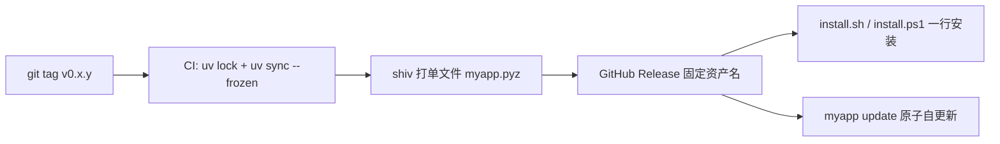

# Python 项目最小发版模式（定案）

> 适用画像：**纯 Python CLI · 公开开源 · 全平台 · 频繁发版 · 用户零参与 · 一条命令安装**。
> 本文档为既定方案，同类项目一律采用，不再逐次讨论。

## 定案清单（decision settled）

1. **tag 即发版**：发布动作收敛为 `git push --tags`，版本号从 tag 派生，代码中不手写版本。
2. **自更新子命令**：CLI 内置 `myapp update`，原子替换，失败自动保留旧版。
3. **curl 一行零交互安装**：用户全旅程只有一条命令，脚本不读 stdin、不提问、无 sudo、PATH 自动处理。
4. **产物 = zipapp 单文件**：依赖在 CI 构建时全部打入 `.pyz`，用户侧零 pip、零 venv、零依赖解析。
5. **托管 = GitHub Releases 固定资产名**：`releases/latest/download/<file>` 即永久 latest 指针，不维护独立 latest.json。
6. **PyPI 仅可选生态入口**：可另发 wheel 供 `pip install`；该渠道依赖在装机时解析，属便捷入口，不是受控通道；自更新只认 zipapp。

## 架构总览



## 四组件

### 1. tag 即发版

- 版本事实源：git tag，`setuptools-scm` / `uv-dynamic-versioning` 派生版本号。
- 发版摩擦必须趋近零：CI 监听 `on: push: tags`，一次推送完成构建、校验、上传。
- 产物不可变：同一 tag 的资产字节永不变化，`SHA256SUMS` 随版发布。

### 2. 产物：zipapp 单文件

```
CI 构建序:
  uv lock                      # 依赖全量锁定（uv.lock 入库）
  uv sync --frozen             # 精确按锁安装，解析只发生在发版时
  shiv -c myapp -o myapp.pyz   # 依赖打入单文件
  生成 SHA256SUMS + version.json（{"version":"1.2.3","sha256":"…"}）
```

- 纯 Python → **一个 .pyz 通吃 macOS/Linux/Windows**，无平台构建矩阵。
- 用户机唯一运行时依赖是 python3 ≥ 3.10（安装脚本兜底）。
- 已知代价：shiv/pex 首次启动解压依赖缓存，约 1s 冷启动。

### 3. 安装：一行命令，零交互

```bash
# macOS / Linux / WSL2
curl -fsSL https://github.com/<owner>/<repo>/releases/latest/download/install.sh | sh

# Windows (PowerShell)
powershell -c "irm https://github.com/<owner>/<repo>/releases/latest/download/install.ps1 | iex"
```

| 环节 | 非交互保证 |
|---|---|
| 脚本输入 | 管道已断 tty，不读 stdin；目录固定 `~/.myapp`（Windows `%LOCALAPPDATA%\myapp`） |
| Python 兜底 | 无 python3 时自动装 uv + `uv python install`（uv 全程非交互） |
| PATH | 优先 `~/.local/bin`；不在 PATH 则自动追加 `.bashrc`/`.zshrc`（Windows `setx` 写用户 PATH），只打印动作，不请求确认 |
| 权限 | 全部落用户家目录，无任何提权步骤 |
| 装完输出 | 一行 `myapp --version` 验证提示，不开浏览器不弹窗 |
| shim | POSIX：三行 bash（unset PYTHONPATH/PYTHONHOME → exec venv 外的 .pyz）；Windows：`.cmd`（`@python "%USERPROFILE%\.myapp\bin\myapp.pyz" %*`） |

判定规则：凡需要用户回答、点击、手动改 PATH 的步骤一律不允许存在——要么自动决策，要么默认值兜底。

### 4. 自更新：notify + 原子替换

- 运行时检查（每次启动或每日一次）拉 `releases/latest/download/version.json` 比对，有新版打印一行提示，不打断。
- `myapp update`：下载 .pyz.tmp → 校验 sha256 → rename 原子替换 → 旧版保留 `previous/`。
- 内部零确认；校验失败自动中止并保留旧版，不存在半更新状态。

## 四条不变量

| 不变量 | 拦截的故障 |
|---|---|
| 同 tag 产物字节不可变 + SHA256SUMS | 供应链事故："同一版本"各处字节不同 |
| shim 清洗 PYTHONPATH/PYTHONHOME 再 exec | 用户 shell 环境泄漏打崩运行时 |
| 数据目录与代码分离（`MYAPP_HOME` 可迁）+ 配置迁移函数链（vN→vN+1 逐级升） | 升级丢用户数据；跳版升级失败 |
| 更新失败保留旧版（previous/） | 半更新把用户锁在门外 |

## 明确不做（过度设计边界）

- **不发 PyPI**（默认）：发布走 Releases；PyPI 可以后补一个 wheel 发布步骤，仅当需要 `pip install` 生态入口时。
- **不做多平台原生二进制**：PyInstaller 式构建是频繁发版下的持续税（构建矩阵、体积、误报），除非出现性能硬指标。
- **不发明版本协商协议**：`version.json` 一个指针足够；灰度需求用双 channel（stable tag / main 构建）表达。
- **不装系统包、不提权**：依赖纯 Python 特性把系统层排除在外。

## 落地文件清单（约 200 行）

| 文件 | 职责 |
|---|---|
| `pyproject.toml` | `[project.scripts]` 入口 + setuptools-scm 版本派生 |
| `.github/workflows/release.yml` | on: push tags → lock/frozen → shiv → 上传三资产（固定名） |
| `install.sh` | POSIX 零交互安装（含 uv/Python 兜底、PATH、shim 写入） |
| `install.ps1` | Windows 零交互安装（.cmd shim、setx PATH） |
| CLI `update` 子命令 | version.json 比对 → 下载校验 → 原子替换 → previous 回滚位 |

## 偏离时的档位（按例外逐次评估，不预先实现）

| 偏离 | 换用 |
|---|---|
| 引入 C 扩展 / 重二进制依赖 | 按平台 wheel（cibuildwheel）或回退"源码 tarball + uv sync --frozen"（Hermes 式） |
| 冷启动 1s 不可接受 | 源码 tarball + uv sync --frozen：安装慢几秒换零解压 |
| 项目转私有 | Releases 私有库同样成立（token 下载）；PyPI 路线作废 |
| 需要 `pip install` 生态入口 | CI 加 `uv publish` 发 wheel，定性为便捷渠道 |

## 参考

- 非交互安装与自管工具链范式：Hermes Agent 安装文档（install.sh/ps1、PM 锁定工具链、零点击约束）——https://hermes-agent.nousresearch.com/docs/getting-started/installation
- 永久 latest 指针：GitHub Releases `releases/latest/download/<asset>` 固定资产名行为
- 锁定与打包：uv（lock/frozen/python install）、shiv（zipapp 打包）
