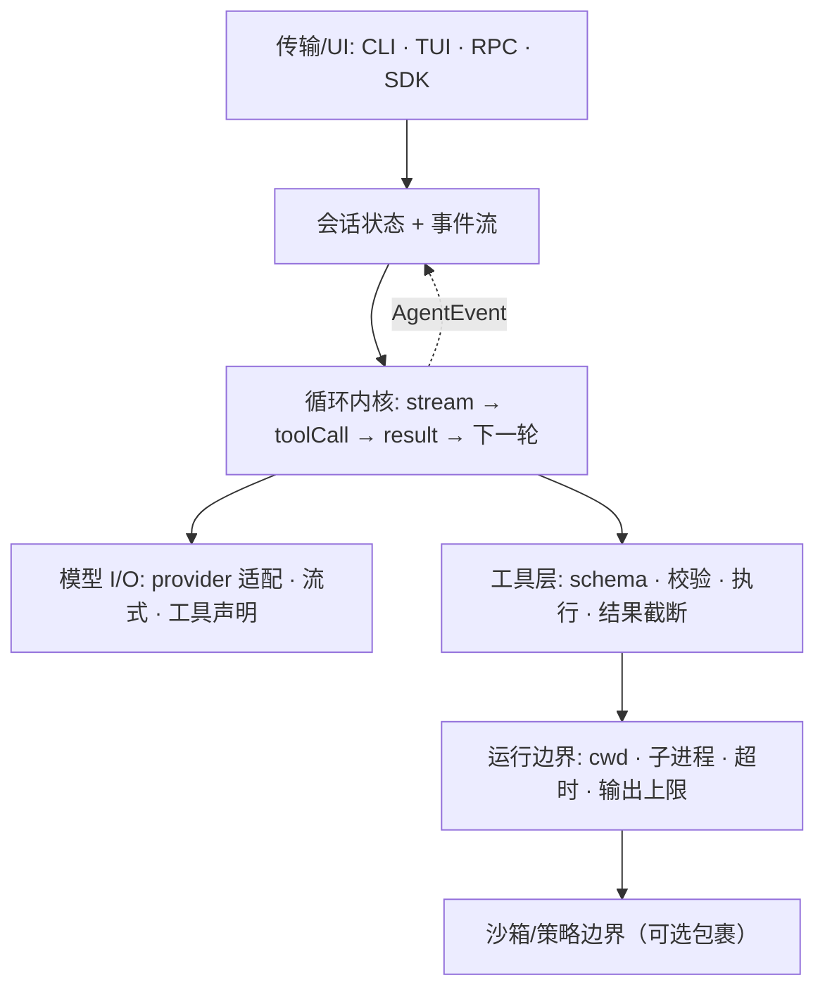

# 最小 AgentLoop 实现学习笔记

日期：2026-10-28
参考实现：Pi（`@earendil-works/*`，本机源码 `/Users/lmqhx/code_space/pi`，`agent-loop.ts` 803 行）
定位差异：桌面已有《Pi-分层结构详解》讲包边界，本文只讲「循环本身最小到什么程度」。

## 结论

Pi 是**最小 agent loop 内核**的干净实现，但不是**最小 agent**：它明确不含权限系统与沙箱，把隔离外推给容器。它的价值在于给出一条可复用的切分线——哪些东西属于循环、哪些必须留在循环外。

## 0. 先定判定规则

说「最小」必须绑定属性，否则是无意义的争论：

| 属性 | 含义 | Pi 是否承诺 |
|---|---|---|
| 功能性最小 | 能完成「模型 → 工具 → 模型」多次往返并正确终止 | 是 |
| 安全性最小 | 模型输出不可能触碰未授权资源 | 否，外置给容器 |
| 可交付最小 | 可中断、可恢复、可观测、上下文不溢出 | 是（这就是它比 20 行代码长 40 倍的原因） |

## 1. 不可约内核

```ts
let messages = [systemPrompt, userTask];
while (true) {
  const reply = await llm(messages, tools);      // 唯一模型出口
  messages.push(reply);
  const calls = reply.toolCalls ?? [];
  if (!calls.length) break;                       // 唯一自然终止点
  for (const c of calls) {
    let result;
    try { result = await tools[c.name](c.args); } // 参数校验在工具里，不在循环里
    catch (e) { result = { isError: true, text: String(e) }; }
    messages.push({ role: "toolResult", id: c.id, ...result }); // 错误变成结果，不抛出
  }
}
```

四条不变式，缺一条就会在真实 provider 上立刻坏掉：

1. **配对**：每轮恰好一条 assistant 消息，每个 toolCall 恰好一条 toolResult；缺一条，Anthropic/OpenAI 直接 400。
2. **错误平面化**：工具异常必须转成 toolResult，绝不穿透循环——否则一次 `ENOENT` 就结束整个 agent。
3. **截断不执行**：`stopReason === "length"` 时 toolCall 参数可能是半截 JSON，必须整批判失败而不是硬跑。
4. **终止只看语义**：无工具调用、或显式 stop；不用轮数上限当终止条件（轮数是保险丝，不是条件）。

## 2. Pi 的切片



| 层 | 最小形态 | Pi 的落点 | 删掉后 |
|---|---|---|---|
| 循环内核 | 20–40 行 while + 两次 append | `runLoop`（`agent-loop.ts:156`），内层 `while (hasMoreToolCalls \|\| pendingMessages)`，外层处理 follow-up | 就不是 agent |
| 模型 I/O | 一次 `fetch` + 消息转换 | `pi-ai`：多 provider、流式增量、工具声明 | 换 provider 要改内核 |
| 工具层 | 一个 `bash` 就够跑 | `createCodingTools` = read/bash/edit/write 四件套；`createAllToolDefinitions` 另有 grep/find/ls/powershell | 没有观测面 |
| 会话状态 | 数组 + `AbortController` | `EventStream<AgentEvent>`、steering / follow-up 队列 | 一次性、不可打断 |
| 上下文管理 | 无（赌窗口够大） | `prepareNextTurn` 挂压缩；`declareToolChanges` 把工具集变更做成 system 消息增量 | 长任务必崩 |
| 运行边界 | `child_process.spawn` | `bash-executor.ts`、`exec.ts`、`output-guard.ts` | 一条 `yes` 打爆内存 |
| 沙箱/策略 | **无** | 内核不含；`docs/containerization.md` 三种外挂 | 功能全过，安全属性归零 |

关键一处设计：`declareToolChanges` 把「模型可调用的工具集」与「运行时实际可执行的工具集」的差量写成 system 消息，让重放始终收敛到 `context.tools`。动态工具集下这是最难自洽的点。

## 3. 那 800 行里多出来的是什么

每一项都能对应一个具体故障，不是抽象洁癖：

| Pi 的机制 | 没有它会发生的故障 |
|---|---|
| `AbortSignal` 贯穿 stream 与工具 | Ctrl-C 只停 UI，进程还在跑工具 |
| `getSteeringMessages` | 用户中途插话只能排队等下一轮 |
| `getFollowUpMessages` | agent 自认完成，但你的后续指令被丢弃 |
| `stopReason: error/aborted` 分支 | 网络错误被当成「任务完成」 |
| `failToolCallsFromTruncatedMessage` | 执行半截 JSON 参数，产生诡异副作用 |
| `finishTurn` 返回 `{action:"end"/"continue"}` | 无法在循环外扩展停止策略 |
| `executeToolCallsSequential/Parallel` | 文件写冲突，或该并行的 IO 串行拖慢 |
| 工具输出截断/累积 | 一次 `cat` 大文件把上下文打爆 |

## 4. 自建切片顺序

每片独立可验证，且验证方式都是**跑起来看**，不是跑测试：

| 切片 | 交付物 | 验收（可观察） |
|---|---|---|
| S0 单次调用 | 消息类型 + provider 适配 | 一条 prompt 得到一条回复 |
| S1 循环 | while + toolCall 分派 | 任务需要 2 次工具调用才完成，单进程内跑完 |
| S2 工具集 | read/write/edit/bash + 结果截断 | 工具报错后循环继续，模型看到错误文本 |
| S3 会话状态 | 追加式消息 + 事件流 + 中止 | 运行中 Ctrl-C 立即停，历史完整 |
| S4 上下文 | system prompt + 压缩 + 工具声明增量 | 超出窗口仍能继续，重放一致 |
| S5 运行边界 | 子进程 / 超时 / 输出上限 | `yes` 不 OOM，超时返回错误结果 |
| S6 沙箱 | 容器或 microVM，凭据留宿主 | 沙箱内读不到宿主凭据 |
| S7 传输 | CLI/TUI/RPC | 同一内核在批处理与交互下行为一致 |

S0–S2 就是「最小 agent loop」；S5 是「不把自己搞崩」的下限；S6 是可选边界层。

## 5. 沙箱的定性

沙箱不属于 loop 的最小实现，属于「安全性最小」。判据只有一条：**模型输出是否可能触碰你不愿授权的资源**（凭据、网络、宿主文件系统）。

- 只在自己机器、自己仓库、自己密钥下运行 → 可选加固；
- 多租户、CI 共享机、带生产凭据 → 交付前提。

归属上：沙箱是**执行侧**，不是 harness 侧。harness 只能「请求」动作，真正的授权与拒绝必须由被执行的一方独立完成——Pi 把这一步完全留白，所以它只能靠容器把整个进程关起来。

## 6. 六个常见错误

1. 把 UI/日志写进循环 —— 循环测试就不再是纯函数式的消息序列。
2. 工具异常直接抛 —— 一次失败终止整个任务。
3. 无终止条件，只靠最大轮数 —— 模型会「礼貌地」永远再调一次工具。
4. 工具结果不截断 —— 上下文被单个输出占满，压缩也救不回来。
5. 把 toolCall 与 toolResult 乱序或合并 —— provider 直接报错。
6. 把沙箱当成 loop 的内建部分 —— 循环被迫知道容器细节，测试全要 Docker。

## 7. 自测清单

证明「我的实现确实是最小可用」的最小验证：

- 一个必须有 2 次工具调用才能完成的任务，单进程跑通；
- 让工具故意抛异常，模型看到错误并自行换路径；
- 运行中按 Ctrl-C，进程退出且 transcript 完整；
- 造一个超长输出，验证截断后仍能继续；
- 让模型返回 `stopReason: length` 的 toolCall，验证未执行；
- 换一个 provider，内核代码零改动。

## 参考

- 内核：`packages/agent/src/agent-loop.ts:156`（`runLoop`）、`:379`（`failToolCallsFromTruncatedMessage`）、`:409`（`executeToolCalls`）
- 工具：`packages/coding-agent/src/core/tools/index.ts:182`（`createAllToolDefinitions`）、`:195`（`createCodingTools`）
- 隔离：`packages/coding-agent/docs/containerization.md`；根 README「Permissions & Containerization」
- 上游：https://github.com/earendil-works/pi
